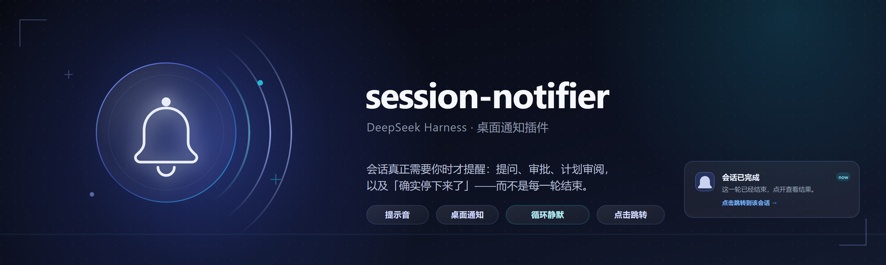

<p align="center">
  
</p>

<p align="center">
  <a href="./LICENSE"></a>
  <a href="https://github.com/Dynesshely/dsh-plugin-notify"></a>
  
  
  = 20">
  <a href="https://github.com/Dynesshely/dsh-plugin-notify/pulls"></a>
</p>

## Introductions

DeepSeek Harness（DSH）的通知插件：**会话真正需要你的时候**，响一声并弹一条桌面通知。

难点不在弹通知，而在**判断什么时候不该弹**。一轮结束不等于轮到你：目标循环、定时任务、排队续跑都会自己开下一轮，子代理完成时真正要等的是派它出去的那个会话。照「结束就提醒」做出来的插件，会在一整段自动续跑里响个不停，最后被关掉——那等于没有。

所以这里做的是一套判定表：

| 你的会话发生了什么 | 提醒 |
| --- | --- |
| 提问、审批、计划审阅 | **立刻提醒**（它此刻就是在等你，不需要观望） |
| 一轮结束、确实停下来了 | 等 **1.2s** 静默期；会话带着进行中的目标则等 **15s** |
| 循环 / 目标轮次续跑 | **静默**：静默期内又跑起来就丢弃 |
| 子代理（含 Agent Teams 队友）自己的会话完成 | **默认静默**（主会话会汇报结果，可开） |
| 子代理停下来提问或要审批 | **提醒**（只有你能推动它，标为「子代理 xxx」） |
| 你正在盯着那个会话（窗口聚焦 + 在主视图） | **跳过**（判定在投递那一刻求值，不是候选登记时） |
| 你回到会话继续输入了 | 那条旧通知**自动撤下**——它已经过期了 |

两个静默窗口不是拍脑袋定的：从本机约 500 个 DSH 会话日志里按「谁唤醒了下一轮」分组量过，目标轮次续跑 **p99 ≈ 375ms**（1.2 秒窗口能 100% 吸收），而人类接手的间隔中位数约 **6 分钟**——差两三个数量级，所以这件事可以判定，不需要猜。复算脚本在 [`tools/probe-round-cadence.mjs`](./session-notifier/tools/probe-round-cadence.mjs)，可在这台机器上重跑。

提醒方式两路独立：**Web Audio 实时合成的提示音**（交互与完成是不同的两声，900ms 冷却）和**桌面通知**（Windows 上有个坑：toast `tag` 超过 16 字符会被系统静默拒绝，所以 tag 做了短化）。

> **为什么仓库里只有一个插件。** 这里曾经按「桌面端 / 服务端」维护两个实现。扫描后确认两端没有平台级差异——Host 半边都是空实现，注入同一批 Client 服务，用同一套 Web Audio + Notification 投递，桌面端唯一的 Electron 特征只是诊断文案。双线维护只会带来行为漂移和同一个 bug 修两次，所以合并成了根目录下的 `session-notifier/`。`clients/desktop` 与 `clients/server` 两条分支保留为历史归档，不再更新。

即时生效：插件是纯客户端半边（Host 半边为空），改完**刷新页面**即可，不需要重启 DSH。

## How to Install

需要 DSH **Desktop**；插件平台声明是 `web`，跟着桌面版的页面走。

用 DSH 的插件管理器安装，参数是这个目录的绝对路径：

```text
plugin_manager install_bundle  ->  <仓库路径>/session-notifier
plugin_manager remove_bundle   ->  dsh-session-notifier
```

想让源码改动即时生效，用 `link:` 方式安装（DSH 会把它链进 profile 的 `node_modules`），之后改 `client.js` **刷新页面**就生效。

装好后在 **设置 → 会话提醒** 里见到配置页（同一页面也注册在 **设置 → 插件 → 会话提醒** 页签）：

- **提醒方式**：总开关、提示音、桌面通知
- **提醒范围**：正在查看的会话不提醒 / 子会话完成也提醒 / 子会话交互也提醒
- **标题模板**：问题、计划评审、审批、完成四类，`{session}` 替换为会话名，留空用默认文案
- **测试与状态**：立即测试、10 秒后测试、权限状态、上次提醒与诊断

插件**零运行时依赖**，没有构建步骤，也不需要 `npm install`。

## How to Contribute

```bash
# 只需要 Node >= 20，无第三方依赖
node session-notifier/tools/test-session-notifier.mjs   # 行为测试，68 项
cd session-notifier && npm run check                    # 五个文件的语法检查
```

测试是**受控时钟**驱动的：完成类提醒被延迟到会话证明自己停下来之后，不控制时间就没法验证「按住看后续」这件事。新增判定规则时，请把用例加进同一张表，而不是写一个只测实现细节的断言。

提交前请确认：

1. **行为测试全绿**，新行为有自己的用例
2. **别手搓库里已经有的东西**（提示音、markdown、图标都有成熟实现）
3. **改判定条件必须给依据**——阈值、窗口、信号来源都要说清为什么是这个值，能实测的就实测
4. 提交信息用中文 conventional commits（`type(scope): 中文标题`），正文写**动机与取舍**，不只是改了什么

流程：fork → 从 `main` 建分支 → 提交 → 开 PR。行为变更请在 PR 里说明「改之前会怎样、改之后会怎样」，以及你是怎么验证的。

插件自身的实现细节（触发信号来源、设置迁移、降级策略、验证边界）在 [`session-notifier/README.md`](./session-notifier/README.md)。

## Structure

```text
dsh-plugin-notify/
├── docs/
│   └── assets/
│       ├── banner.svg          # 顶部海报的源文件（自绘 SVG）
│       └── banner.png          # 由该 SVG 渲染，README 实际引用的是这张
├── session-notifier/           # 唯一维护的插件
│   ├── package.json            # bundle 清单：dsh.bundle.patch + dsh.client
│   ├── cordis.patch.yml        # 向 profile 插入插件行
│   ├── index.js                # Host 半边，空实现（判定全在页面里）
│   ├── client.js               # 浏览器半边：判定、提示音、桌面通知、设置页、控制台 API
│   ├── locale/{zh,en}.json     # 插件管理页的标题与描述
│   ├── tools/
│   │   ├── test-session-notifier.mjs    # 受控时钟的行为测试（68 项）
│   │   ├── probe-round-cadence.mjs      # 复核 1.2s / 15s 阈值的实测脚本
│   │   └── lib/session-log.mjs          # 会话日志分帧解压（每行一个独立 zstd 帧）
│   └── README.md               # 触发条件、设置、迁移、验证
├── LICENSE
└── README.md
```

`clients/desktop` 与 `clients/server` 两条分支是合并前的历史归档，**新代码只进 `main`**。

## Star History (Dark Mode)

<a href="https://star-history.com/#Dynesshely/dsh-plugin-notify&Date">
  
</a>

## License

[MIT](./LICENSE) © 2026 [Dynesshely](https://github.com/Dynesshely)
